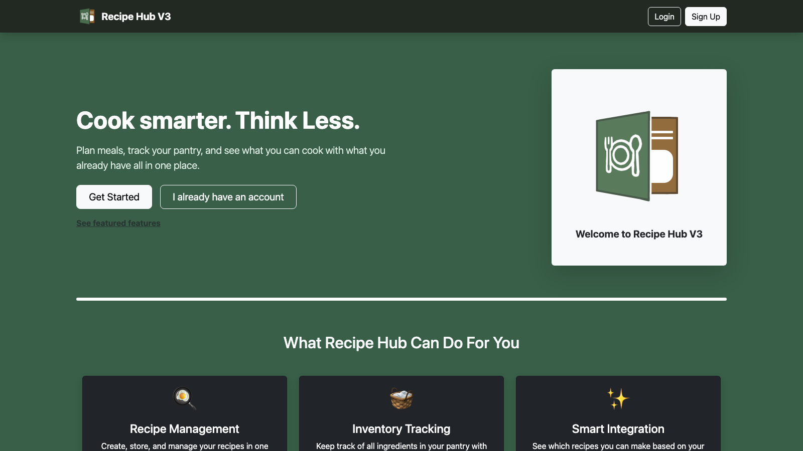
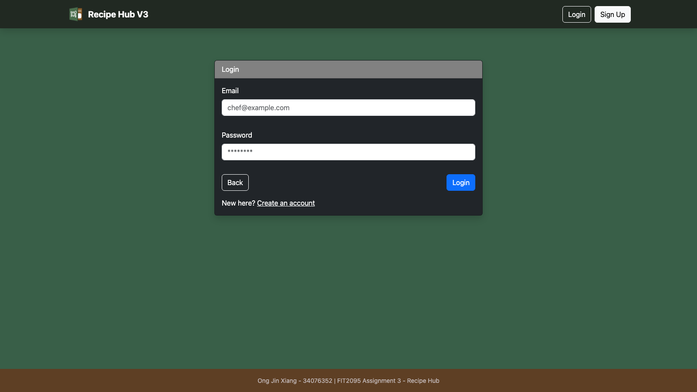
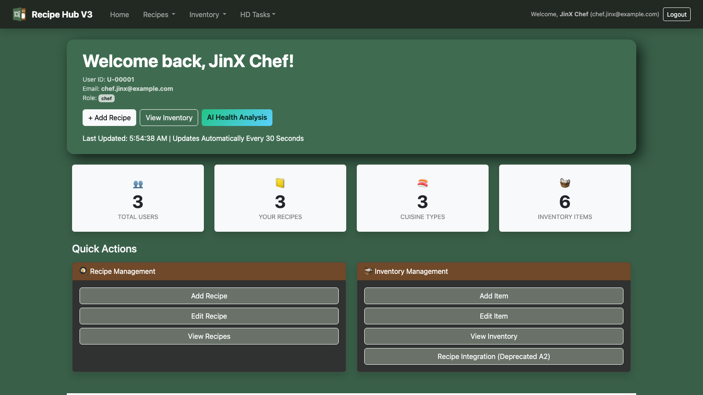
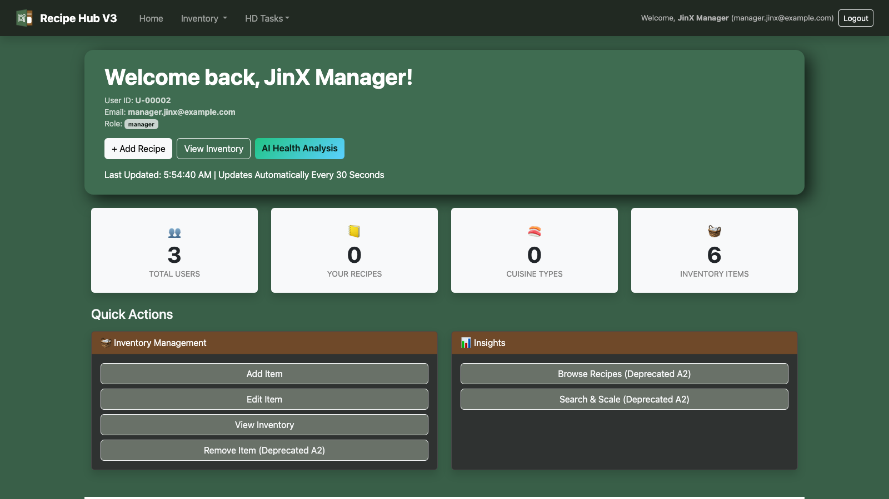
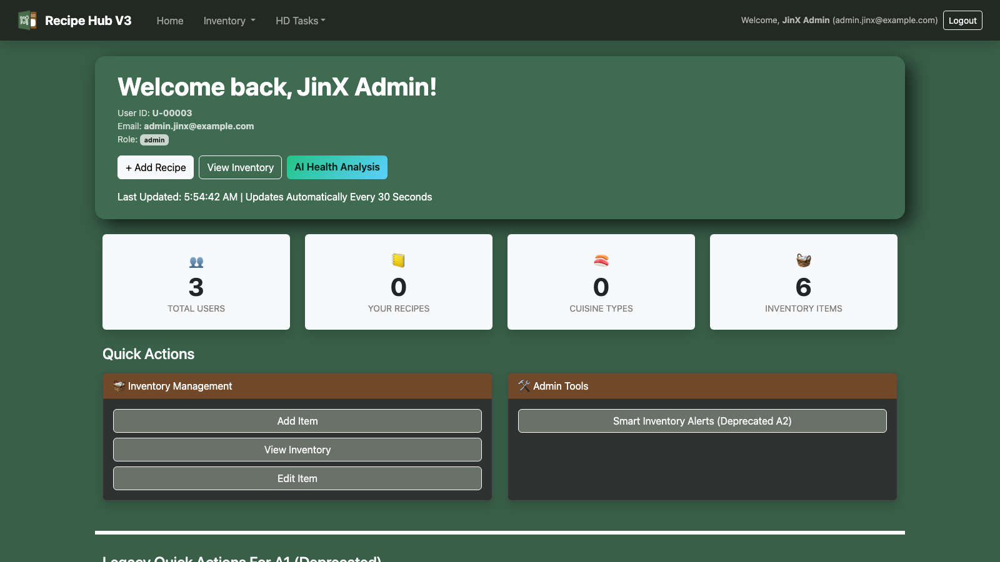
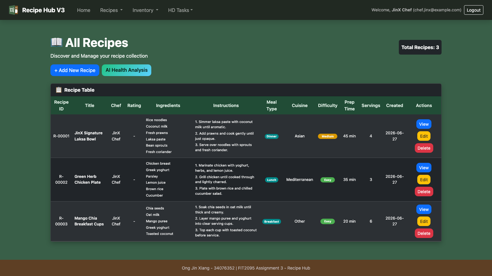
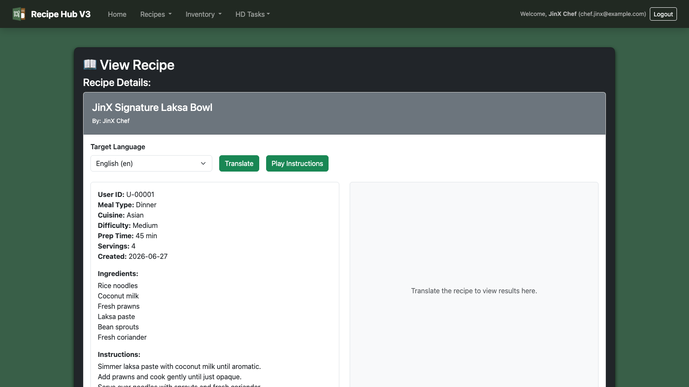
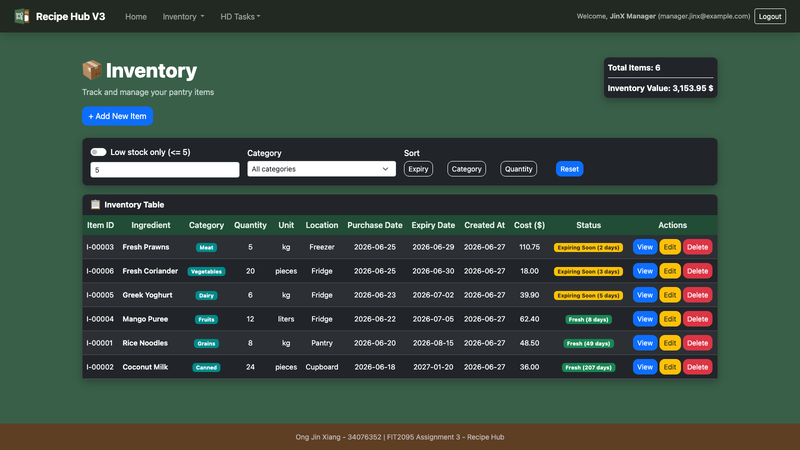
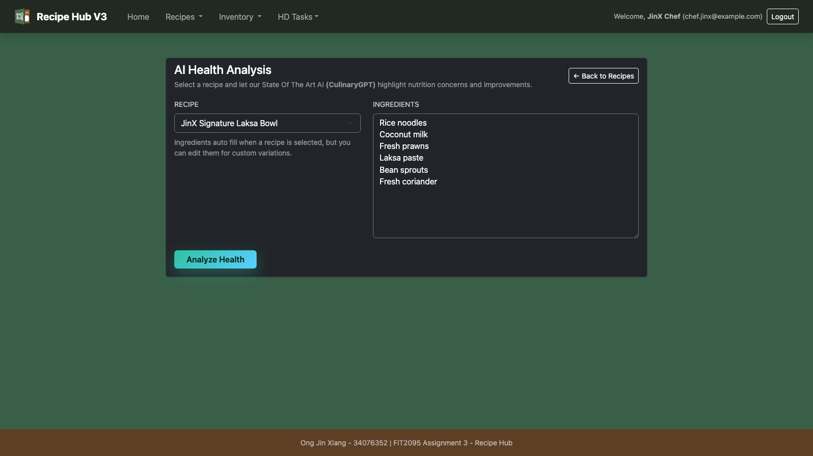

# CloudKitchen Pro

CloudKitchen Pro is a recipe and kitchen-inventory management application built across three FIT2095 assignment milestones. The final version is an Angular 20 single-page app backed by an Express and MongoDB API, with role-aware dashboards, recipe CRUD, inventory tracking, PWA configuration, and optional Google AI, Translate, and Text-to-Speech integrations.

The root of this repository contains the final Angular version. Earlier assignment work is kept in the Git history instead of being left as separate top-level folders.

## Screenshots

| Welcome | Login |
| --- | --- |
|  |  |

| Chef Dashboard | Manager Dashboard | Admin Dashboard |
| --- | --- | --- |
|  |  |  |

| Recipes | Recipe Detail |
| --- | --- |
|  |  |

| Inventory | AI Health Analysis |
| --- | --- |
|  |  |

## Project Progression

- Assignment 1 started as an Express and EJS recipe hub with in-memory recipe and inventory data.
- Assignment 2 added MongoDB, Mongoose models, users, role-based navigation, CRUD flows, and dashboard statistics.
- Assignment 3 moved the frontend to Angular and connected it to the Express API, with guarded routes, services, PWA assets, AI health analysis, translation, and text-to-speech support.

## Tech Stack

- Angular 20, TypeScript, Angular Router, Angular Forms
- Bootstrap 5 and ng-bootstrap
- Node.js, Express 5, Socket.IO
- MongoDB and Mongoose
- Google Gemini, Google Translate, and Google Text-to-Speech integrations through backend environment variables

## Features

- Role-aware dashboard for `chef`, `manager`, and `admin` users
- Recipe creation, listing, viewing, editing, and deletion for chefs
- Inventory creation, listing, viewing, editing, deletion, expiry status, filtering, sorting, and value totals
- Protected Angular routes backed by Express API auth checks
- AI recipe health analysis for chef users
- Recipe translation and text-to-speech support when Google credentials are configured
- PWA manifest and icons for installable app support

## Local Setup

Prerequisites:

- Node.js 20+
- npm
- MongoDB running locally, or a MongoDB connection string

Install frontend dependencies:

```bash
npm install
```

Install backend dependencies:

```bash
cd backend
npm install
```

Create a backend environment file:

```bash
cp backend/.env.example backend/.env
```

For a basic local run, `MONGODB_URI` is enough. Google credentials are optional and only needed for AI, translation, and text-to-speech features.

```bash
MONGODB_URI=mongodb://localhost:27017/cloud_kitchen_pro-34076352
GOOGLE_API_KEY=
GOOGLE_APPLICATION_CREDENTIALS=/absolute/path/to/service-account.json
PORT=8080
```

Build the Angular app:

```bash
npm run build
```

Start the backend API and static frontend server:

```bash
cd backend
npm start
```

Open:

```text
http://localhost:8080/welcome-34076352
```

For frontend-only development, run:

```bash
npm start
```

The Angular dev server runs at `http://localhost:4200/`. The production-like flow is the built Angular app served by the backend on port `8080`.

## Academic Integrity Notice

This repository is shared for portfolio and learning reference only.

Do not copy, reuse, or submit any part of this repository as your own academic work. Submitting another student's work, even partially, may be treated as academic misconduct and can result in failed assessments, unit failure, or disciplinary action.

Use this repository to understand implementation ideas and project structure, then complete your own work independently according to your institution's academic integrity rules.
